# ENTREGA 07 — Controle e Sequência de Operações

| | |
|---|---|
| **Data** | 22/10/2026 |
| **Taxonomia de Flynn** | MISD (Multiple Instruction, Single Data) |
| **Projeto** | Computer Architecture Evolution |
| **Grupo** | 03 |

## Integrantes

- Tiago Henrique Souza Lima
- Emanuel Borges Vale
- Elaine Cardoso de Souza Barros
- Augusto Spolavori Siqueira
- João Guilherme Alves de Souza Oliveira
- João Victor Ferreira de Lima Moura

---

## Sumário

1. [Objetivo](#1-objetivo)
2. [Investigação dos Mecanismos de Controle e Sequenciamento](#2-investigação-dos-mecanismos-de-controle-e-sequenciamento)
3. [Exemplo Concreto de Operação](#3-exemplo-concreto-de-operação)
4. [Visão geral do sistema](#4-visão-geral-do-sistema)
5. [CPU](#5-cpu)

---

## 1. Objetivo

Compreender de maneira aprofundada como o sistema determina quais operações devem ser realizadas, a respectiva sequência de execução, os mecanismos de sincronização, repetições, mudanças de fluxo e as condições de encerramento sob a ótica da arquitetura **MISD (Multiple Instruction, Single Data)**.

> **Observação:** MISD é uma classificação conceitual da Taxonomia de Flynn e possui poucas implementações práticas consensuais. Portanto, o modelo apresentado neste documento representa uma arquitetura MISD conceitual, não necessariamente uma implementação específica de uma CPU comercial.

---

## 2. Investigação dos Mecanismos de Controle e Sequenciamento

### 2.1 Como uma operação foi iniciada

No modelo conceitual MISD, uma operação é iniciada quando um único fluxo de dados é disponibilizado para as unidades de processamento. Um mecanismo de controle determina o início da operação e garante que o dado esteja disponível para as diferentes unidades que executarão suas respectivas instruções.

As unidades podem receber instruções diferentes, mas todas trabalham sobre o mesmo fluxo de dados. O mecanismo de sincronização garante que cada unidade receba o dado no momento adequado para a execução de sua operação.

### 2.2 Como a próxima operação é determinada

A próxima operação é determinada pela sequência de instruções associada a cada fluxo de processamento. Em uma implementação com unidades de controle independentes, cada unidade pode possuir seu próprio Contador de Programa (PC) e determinar sua próxima instrução de acordo com sua sequência de execução.

Entretanto, a existência de PCs independentes, memórias de instrução separadas ou de uma unidade de controle global **não é uma característica obrigatória** da classificação MISD. Esses elementos dependem da implementação utilizada.

Quando existe dependência entre operações, o mecanismo de controle e sincronização garante que o dado ou resultado necessário esteja disponível antes da execução da próxima etapa.

### 2.3 Mecanismos de controle

O sistema de controle pode ser distribuído entre as unidades de processamento e mecanismos de coordenação global:

- **Unidades de Controle Locais:** cada unidade pode gerenciar a busca, decodificação e execução de sua própria instrução.
- **Unidade de Controle Mestra (Global):** pode ser utilizada em determinadas implementações para coordenar a distribuição do dado, a sincronização das unidades e a ordem de determinadas operações.
- **Contadores de Programa:** quando presentes, determinam a próxima instrução de cada fluxo.
- **Sinais de sincronização:** indicam quando uma unidade pode iniciar ou continuar uma etapa do processamento.

A arquitetura MISD não exige necessariamente uma única unidade de controle mestre. A forma de implementação do controle depende do sistema projetado.

### 2.4 Sequência de execução

A sequência de processamento de uma tarefa pode ser representada pelas seguintes etapas:

1. **Busca do Dado Único:** o dado é recuperado da memória ou recebido de uma fonte de entrada.
2. **Distribuição do Dado:** o mesmo dado é disponibilizado para as unidades de processamento.
3. **Busca de Instruções (Fetch):** cada unidade obtém a instrução correspondente ao seu fluxo.
4. **Decodificação (Decode):** cada unidade interpreta sua instrução.
5. **Execução Simultânea (Execute):** as diferentes unidades aplicam suas operações sobre o mesmo fluxo de dados.
6. **Produção dos Resultados:** cada unidade produz seu resultado parcial ou transformado.
7. **Comparação ou Consolidação:** os resultados podem ser comparados, combinados ou encaminhados para uma etapa posterior.
8. **Continuação ou Encerramento:** o mecanismo de controle determina se uma nova operação deve ser realizada ou se a tarefa foi concluída.

**Representação da sequência**

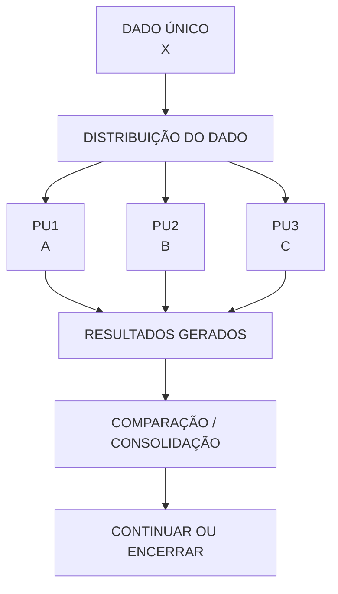

> O modelo tradicional *Fetch → Decode → Execute → Write Back* pode existir internamente em determinadas unidades, mas não deve ser considerado uma característica obrigatória da arquitetura MISD. O aspecto central é a existência de **múltiplas instruções atuando sobre um único fluxo de dados**.

### 2.5 Sincronização

A sincronização é necessária para garantir que as unidades trabalhem com dados válidos e que uma etapa não utilize um resultado antes que ele esteja disponível.

Dependendo da implementação, podem ser utilizados:

- **Barreiras de Clock Global:** podem sincronizar as transições entre determinadas etapas em uma implementação síncrona.
- **Buffers Intermediários (Latches):** podem manter dados e resultados estáveis durante a execução.
- **Sinais de pronto/concluído:** indicam quando uma unidade terminou uma operação.
- **Controle de dependências:** garante que uma etapa não seja executada antes que seus dados necessários estejam disponíveis.

O uso de um clock global e de barreiras globais é uma possibilidade de implementação, não uma exigência da arquitetura MISD.

**Representação da sincronização**

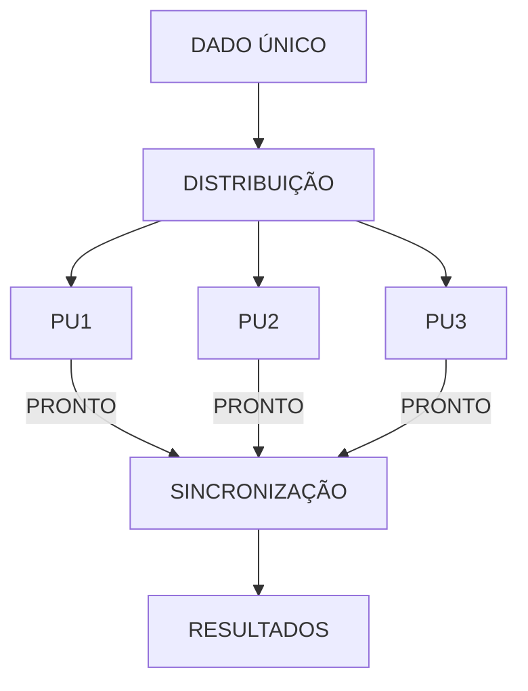

### 2.6 Repetições

As repetições podem ocorrer quando uma tarefa precisa processar vários elementos do fluxo de dados ou quando uma condição exige que uma determinada operação seja executada novamente.

As repetições podem ser controladas por:

- laços de execução (loops);
- contadores;
- instruções de salto;
- condições de término;
- controle da entrada de novos dados.

Enquanto houver novos dados disponíveis ou enquanto uma condição de repetição for verdadeira, a sequência de processamento pode ser executada novamente.

**Representação de uma repetição**

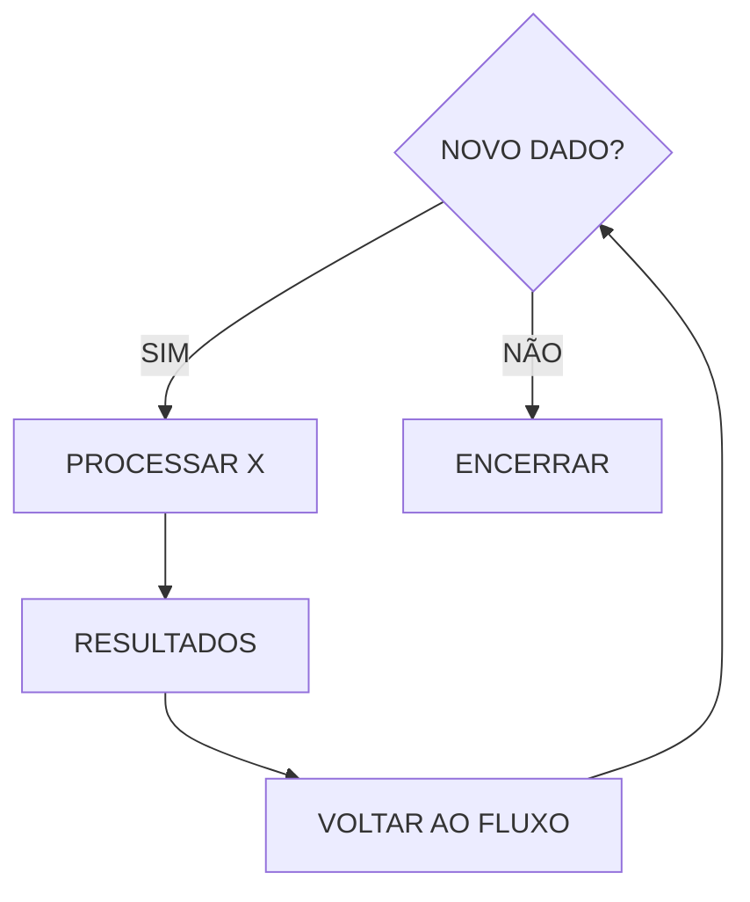

### 2.7 Mudanças no fluxo

O fluxo de execução pode mudar de acordo com as condições encontradas durante o processamento.

Instruções de desvio condicional ou incondicional podem alterar a sequência normal de execução quando suportadas pela implementação. Uma condição pode fazer com que determinada unidade continue pela sequência normal, execute uma sequência alternativa, repita uma operação ou interrompa seu processamento.

Em uma implementação com unidades de controle independentes, diferentes fluxos de instruções podem possuir mecanismos próprios de desvio. Entretanto, esse comportamento depende da implementação concreta e não constitui uma característica obrigatória da classificação MISD.

**Representação de mudança de fluxo**

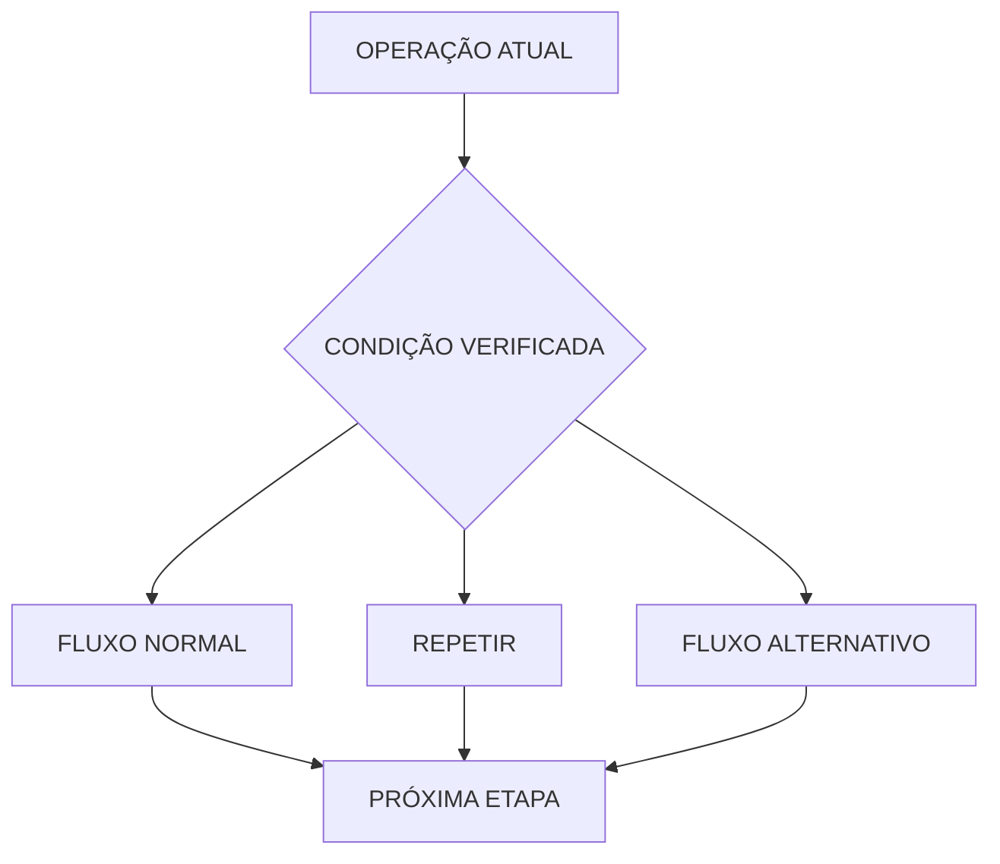

### 2.8 Exceções (quando existentes)

Operações inválidas ou que não se aplicam ao estado atual do dado podem ser tratadas por mecanismos de exceção, interrupção, sinalização de erro ou anulação da operação.

Instruções como **NOP** (No Operation) também podem ser utilizadas em determinadas implementações para preencher ciclos ou impedir a execução de uma operação específica, mas seu uso não constitui uma característica exclusiva de MISD.

Quando ocorre uma condição que impede a continuação normal, o mecanismo de controle pode ignorar uma etapa, executar uma sequência alternativa, repetir a operação ou encerrar a tarefa.

**Tratamento de uma operação inválida**

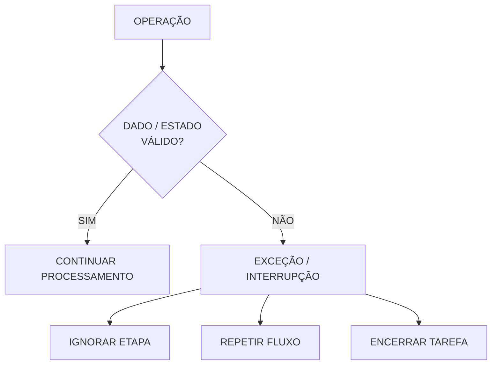

### 2.9 Participação humana sem controle

Em sistemas que utilizam uma arquitetura MISD, a execução das operações ocorre automaticamente pelos mecanismos de hardware e software.

A participação humana ocorre principalmente em um nível superior, por meio da configuração de parâmetros, inicialização ou interrupção da tarefa e definição dos critérios de operação.

Por exemplo, um operador pode configurar os parâmetros de uma tarefa ou solicitar o início de um processamento. Depois disso, o mecanismo de controle executa automaticamente a sequência programada, sem intervenção humana direta em cada ciclo de clock ou instrução.

### 2.10 Condições que encerram uma operação ou tarefa

Uma operação ou tarefa pode ser encerrada quando:

- o fluxo de dados de entrada atinge o fim (End-of-Stream / EOF);
- todas as unidades concluem suas sequências de instruções;
- o resultado final é produzido e validado;
- uma condição de término programada é atingida;
- ocorre uma condição de erro que exige interrupção;
- ou o sistema recebe uma solicitação de interrupção ou parada.

Quando todas as etapas necessárias são concluídas e o resultado final é disponibilizado, a operação pode ser considerada encerrada.

---

## 3. Exemplo Concreto de Operação

### 3.1 Processamento de um único dado por múltiplas instruções

Como exemplo de uma operação típica, considere um sistema que recebe um único valor produzido por um sensor.

Esse valor é disponibilizado para diferentes unidades de processamento. Cada unidade executa uma operação diferente sobre o mesmo dado.

**Diagrama da operação MISD**

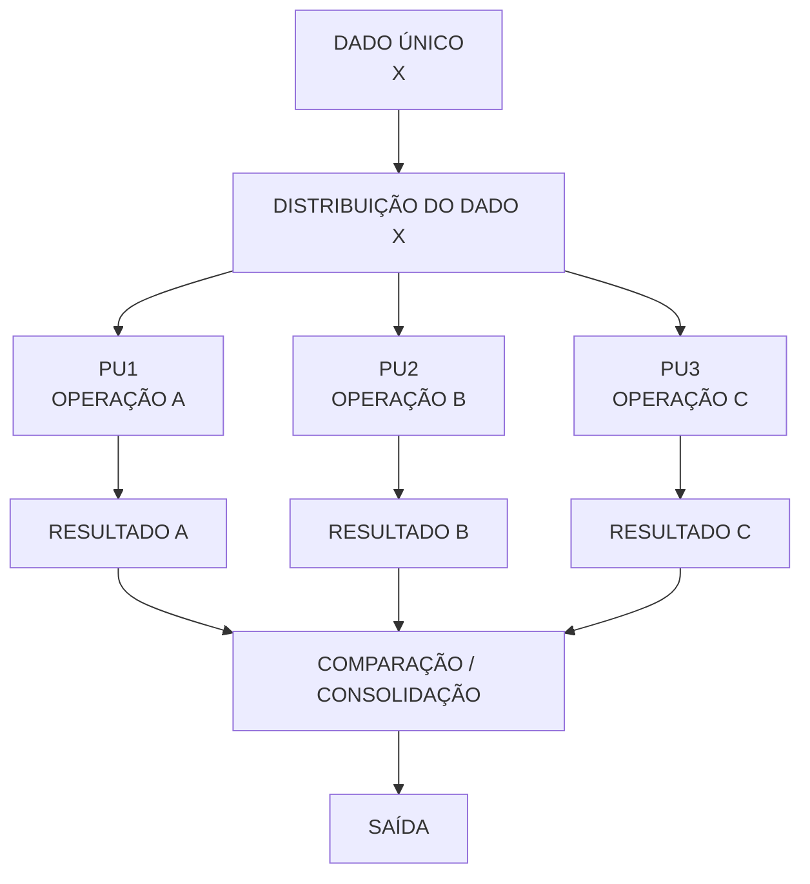

Nesse modelo, o mesmo dado `X` é utilizado pelas três unidades, enquanto cada unidade executa uma instrução ou operação diferente.

Isso representa a ideia central da classificação MISD:

> **Multiple Instruction + Single Data**

### 3.2 Sequência da operação

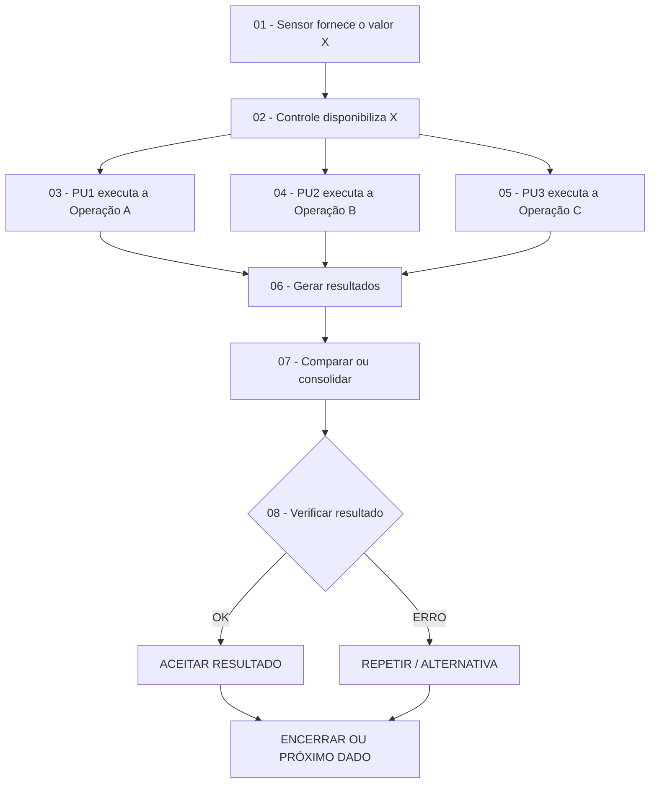

A sequência detalhada é:

1. O sensor fornece o valor X.
2. O mecanismo de controle disponibiliza o valor X para as unidades de processamento.
3. A PU1 executa a operação A sobre X.
4. A PU2 executa a operação B sobre X.
5. A PU3 executa a operação C sobre X.
6. Cada unidade produz seu respectivo resultado.
7. Os resultados são enviados para uma etapa de comparação ou consolidação.
8. O sistema verifica se os resultados atendem aos critérios definidos.
9. Se a condição for satisfeita, o resultado final é aceito.
10. Caso contrário, o mecanismo de controle pode sinalizar um erro, repetir o processamento ou executar uma sequência alternativa.
11. Após a obtenção de um resultado válido, a operação é encerrada ou o sistema recebe o próximo dado do fluxo.

Esse exemplo representa o princípio fundamental do MISD: **múltiplas instruções ou operações atuando sobre um único fluxo de dados**.

---

## 4. Visão geral do sistema

### 4.1 Descrição Geral

O sistema adota a arquitetura MISD (Multiple Instruction, Single Data), onde um único fluxo de dados é processado por múltiplas unidades de execução que aplicam instruções distintas.

Essa organização pode ser utilizada em aplicações que necessitam realizar diferentes transformações sobre o mesmo dado ou comparar resultados produzidos por diferentes unidades de processamento.

Como MISD possui poucas implementações práticas consensuais, o sistema apresentado deve ser entendido como um modelo arquitetural conceitual.

### 4.2 Componentes principais

| Componente | Descrição |
|---|---|
| **CPU** | Composta por múltiplas unidades de processamento capazes de executar diferentes instruções sobre o fluxo de dados. |
| **Memória** | Armazena os dados e, dependendo da implementação, as instruções utilizadas pelas unidades. |
| **Barramentos** | Podem transportar o fluxo de dados e os sinais de controle entre os componentes. |
| **E/S** | Interfaces responsáveis pela entrada do fluxo de dados e pela saída dos resultados processados. |
| **Unidades de Controle** | Responsáveis pela determinação e coordenação da sequência de execução. |
| **Registradores e Buffers** | Armazenam temporariamente dados e resultados intermediários. |

### 4.3 Diagrama de Blocos do Sistema MISD

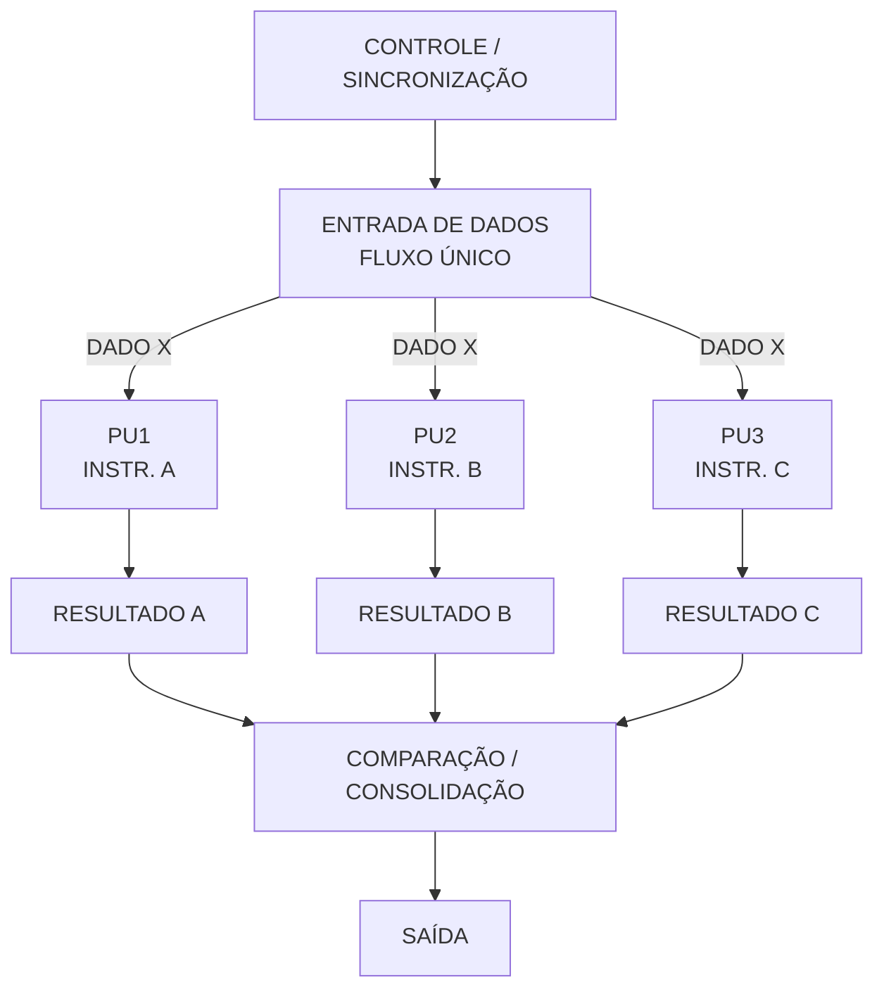

**Interpretação do diagrama**

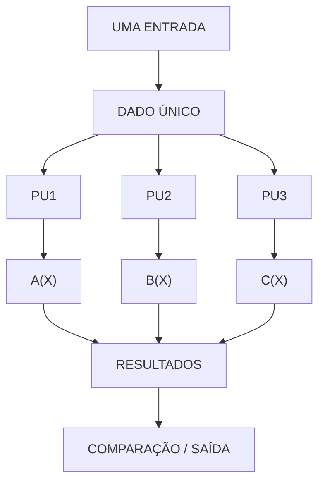

O ponto principal do modelo é que existe um **único fluxo de dados**, enquanto diferentes unidades aplicam **instruções ou operações distintas**.

### 4.4 Fluxo de Dados

O dado único de entrada é disponibilizado às unidades de processamento. Cada unidade aplica sua transformação específica sobre o mesmo dado, de forma concorrente quando a implementação permitir.

Os resultados produzidos podem ser comparados, consolidados ou encaminhados para etapas posteriores, dependendo da finalidade do sistema.

O fluxo exato depende da implementação utilizada.

**Fluxo resumido**

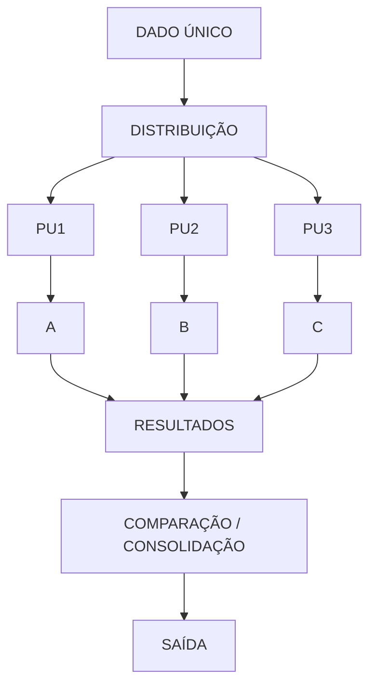

### 4.5 Principais Características

| Característica | Descrição |
|---|---|
| **Arquitetura** | MISD (Multiple Instruction, Single Data) |
| **Fluxo de Dados** | Único |
| **Fluxo de Instruções** | Múltiplo |
| **Processamento** | Diferentes operações podem atuar sobre o mesmo fluxo de dados |
| **Sincronização** | Garante que os dados e resultados estejam disponíveis no momento adequado |
| **Controle** | Pode ser distribuído entre diferentes unidades e mecanismos de coordenação |
| **Aplicabilidade** | Adequada principalmente a aplicações especializadas que necessitam realizar diferentes operações sobre o mesmo dado ou comparar resultados |

---

## 5. CPU

### 5.1 Visão geral do processador

A CPU baseia-se no modelo conceitual MISD, integrando múltiplas unidades de processamento capazes de executar instruções variadas sobre um único fluxo de dados.

Cada unidade pode possuir sua própria lógica de controle e elementos de armazenamento temporário, dependendo da implementação adotada.

### 5.2 Registros

- **Registrador de Entrada de Dados:** mantém temporariamente o operando ou dado que será processado.
- **Contadores de Programa (PC1, PC2, ..., PCn):** quando presentes, gerenciam o fluxo de instruções de cada unidade de forma independente.
- **Registradores de Instrução (IR1, IR2, ..., IRn):** armazenam a instrução ativa em cada unidade.
- **Registradores de Resultado:** armazenam resultados intermediários ou finais.

**Organização dos registros**

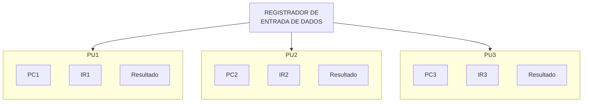

### 5.3 ALU

Múltiplas Unidades Lógicas e Aritméticas podem operar sobre o mesmo fluxo de dados, permitindo que operações matemáticas, lógicas e de verificação diferentes sejam executadas pelas unidades de processamento.

A quantidade de ALUs e sua organização dependem da implementação.

**Organização das ALUs**

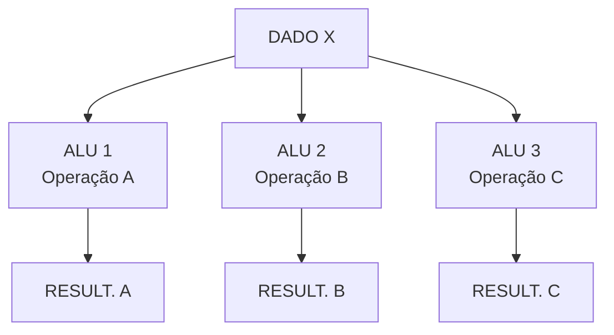

### 5.4 Unidade de Controle

A arquitetura pode utilizar unidades de controle locais em cada unidade de processamento e mecanismos de coordenação global.

As unidades de controle determinam:

- qual instrução será executada;
- quando uma operação pode começar;
- quando um resultado está disponível;
- se uma repetição deve ocorrer;
- se um desvio deve ser realizado;
- e se a tarefa deve continuar ou terminar.

Não é obrigatório que uma arquitetura MISD possua uma única Unidade de Controle Mestra.

**Controle do processamento**

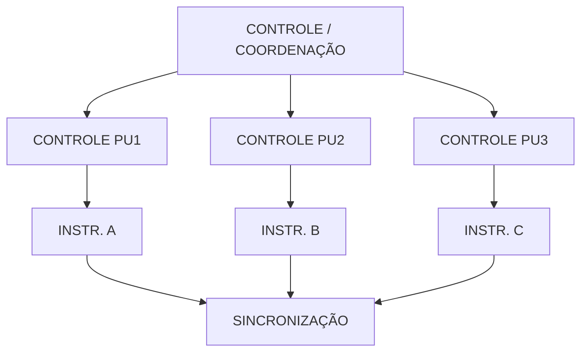

### 5.5 Relógio (Clock)

Quando a implementação utiliza execução síncrona, o sinal de clock fornece uma referência temporal para sincronizar as operações do processador.

Ele pode ser utilizado para sincronizar a leitura dos dados, atualização dos registradores, execução das operações e transferência dos resultados.

Entretanto, a utilização de um único clock global não é uma exigência da classificação MISD.

**Exemplo de sincronização por clock**

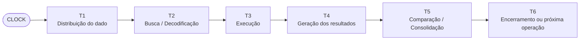

> Os ciclos apresentados são apenas uma representação conceitual da sequência temporal.

### 5.6 Ciclo de Instruções

O ciclo de instruções em uma implementação MISD pode envolver diferentes fluxos de instruções atuando sobre um único fluxo de dados.

- **Explicar:** o modelo MISD permite que diferentes unidades executem instruções distintas sobre o mesmo fluxo de dados.
- **Buscar (Fetch):** cada unidade obtém a instrução correspondente ao seu fluxo, enquanto o dado único é disponibilizado para o processamento.
- **Decodificar (Decode):** cada unidade interpreta sua respectiva instrução.
- **Executar (Execute):** as unidades aplicam suas operações sobre o mesmo dado.
- **Escrita/Resultado (Write Back):** quando aplicável, os resultados são armazenados, comparados, consolidados ou encaminhados para outra etapa.

**Ciclo de instruções no modelo MISD**

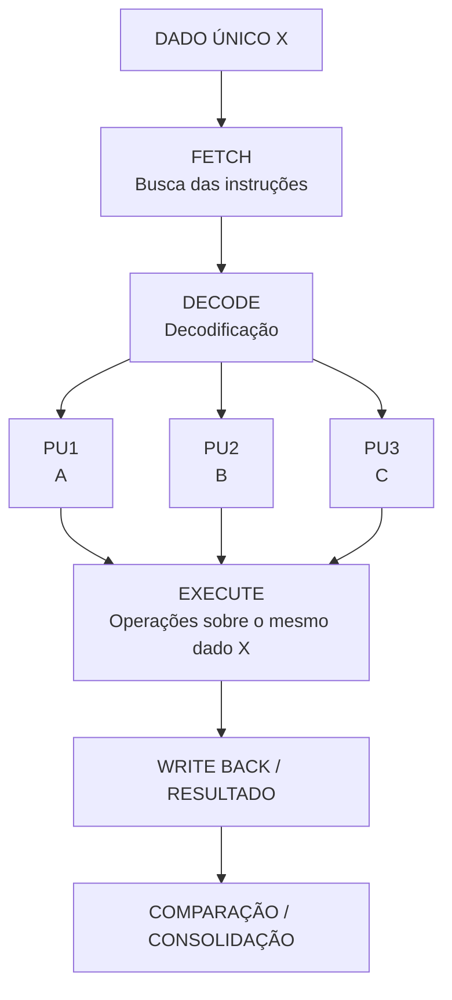

> O modelo *Fetch → Decode → Execute → Write Back* pode existir internamente em cada unidade, mas não representa sozinho a característica MISD. O elemento central é a relação entre **múltiplas instruções e um único fluxo de dados**.

### 5.7 Diagrama da CPU

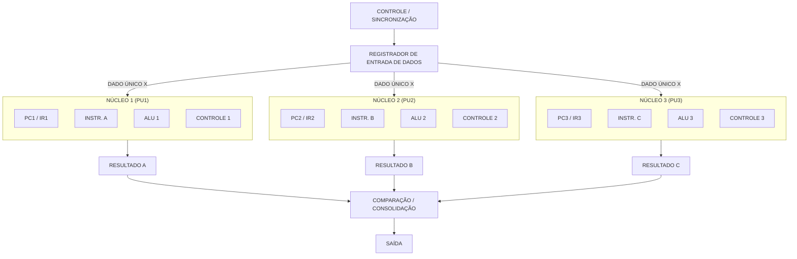

**Visão simplificada da CPU**

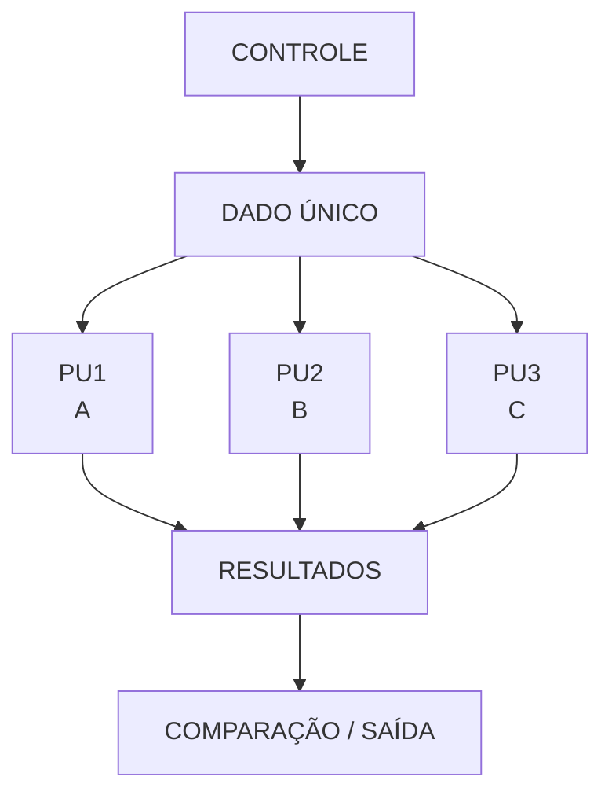

### 5.8 Vantagens

- Alta confiabilidade e possibilidade de redundância em aplicações específicas.
- Possibilidade de executar diferentes operações sobre o mesmo fluxo de dados.
- Possibilidade de comparar ou combinar resultados produzidos por diferentes unidades.
- Potencial para utilização em sistemas especializados de processamento e verificação.
- Possibilidade de aplicar diferentes transformações sobre um mesmo dado.

### 5.9 Limitações

- Complexidade elevada no controle e na sincronização das unidades.
- Restrição de aplicabilidade a cenários computacionais especializados.
- Poucas implementações práticas consensuais da arquitetura MISD.
- Possíveis limitações de desempenho relacionadas à distribuição de um único fluxo de dados.
- A classificação de algumas arquiteturas como MISD pode ser controversa, especialmente em sistemas baseados em pipeline.
