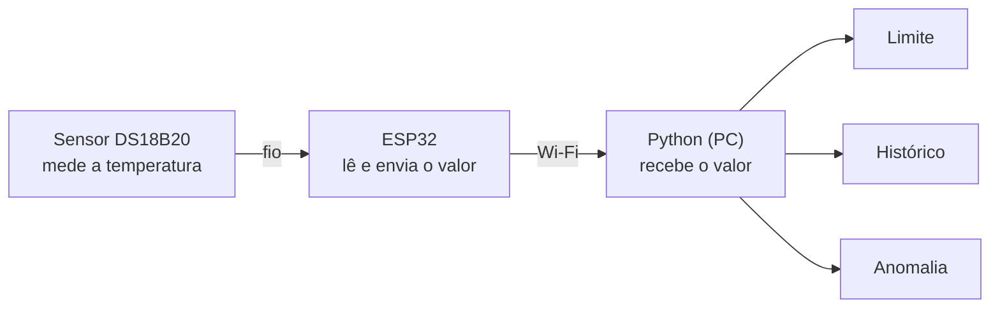

# ENTREGA 10 — Representação de Operações e Acesso aos Dados

**Disciplina:** Arquitetura e Organização de Computadores
**Professor:** Breno Felix Sousa
**Tema do grupo:** MISD (Taxonomia de Flynn)
**Data:** 12/11/2026

**Grupo 03**

- Tiago Henrique Souza Lima
- Emanuel Borges Vale
- Elaine Cardoso de Souza Barros
- Augusto Spolavori Siqueira
- João Guilherme Alves de Souza Oliveira
- João Victor Ferreira de Lima Moura

---

## Objetivo

Nesta entrega investigamos como uma operação identifica, recebe ou localiza os dados de que precisa para ser executada. Aplicamos essa pergunta ao nosso tema, a arquitetura MISD (várias instruções diferentes processando o mesmo dado), usando como exemplo o protótipo de monitoramento de temperatura do grupo.

Em resumo, no MISD existe um único dado, a temperatura, e várias operações trabalhando em cima dele: verificar o limite, comparar com o histórico e procurar anomalias. Por isso a operação não precisa procurar o dado em vários lugares. Ele chega pelo sensor e o mesmo valor é entregue para todas elas. A figura abaixo mostra esse caminho.



*Figura 1: caminho do dado no protótipo. O mesmo dado vai para as três operações.*

---

## Investigação

### 1. Como operandos são fornecidos

Operando é o dado que a operação usa. No protótipo eles chegam de três formas. A temperatura atual vem do sensor, passa pelo ESP32 e chega ao Python, onde fica guardada na variável `temp`. O limite (por exemplo, 30 °C) é um valor fixo escrito no próprio código. Já as leituras anteriores ficam numa lista na memória do programa, chamada aqui de `historico`, e servem de operando para a comparação com o histórico e para a procura de anomalias.

### 2. Como valores são identificados

Cada parte do sistema identifica o dado de um jeito. No sensor, cada DS18B20 tem um código ROM de 64 bits, único, que funciona como um número de série. Na rede, o dado é identificado pelo IP e pela porta do computador que vai recebê-lo. No programa, o valor é identificado pelo nome da variável (`temp`) e, no caso do histórico, pela posição na lista.

O sensor também envia um código de conferência, o CRC, junto com os dados. Com ele o ESP32 consegue perceber que uma leitura veio corrompida e descartá-la.

### 3. Como dados armazenados são localizados

O dado fica guardado em três lugares e é encontrado de formas diferentes. Dentro do sensor existe uma pequena memória chamada *scratchpad*, e a temperatura está nos bytes 0 e 1, lidos com o comando Read Scratchpad. No ESP32, o valor já convertido em graus fica numa variável do programa dele. No computador, o Python guarda as leituras numa lista, e a posição indica qual leitura queremos: `historico[-1]` é a leitura anterior.

### 4. Existência de endereços

Existem endereços, e em vários níveis, um para cada parte do caminho:

- **sensor:** o código ROM de 64 bits, que diz qual sensor deve responder no fio;
- **ESP32:** o pino (GPIO) onde o fio de dados do sensor está ligado;
- **rede:** o IP e a porta, que levam o dado ao computador e ao programa certo;
- **programa:** o nome e a posição da variável, que entregam o valor às operações.

O endereço real de memória no computador não aparece para a gente, porque o Python esconde isso e o sistema operacional resolve por baixo.

### 5. Utilização de registradores

Registrador é uma memória pequena e muito rápida usada na hora do cálculo. O sensor tem registradores próprios, o *scratchpad* de 9 bytes, organizado assim:

| Byte | O que guarda |
|---|---|
| 0 e 1 | temperatura medida |
| 2 e 3 | limites de alarme do próprio sensor (TH e TL) |
| 4 | configuração (define a precisão, de 9 a 12 bits) |
| 8 | código de conferência (CRC) |

No ESP32 e no Python usamos apenas variáveis. Os registradores da CPU são usados pelo processador durante as contas, sem que a gente precise mexer neles.

### 6. Posições, canais ou mecanismos equivalentes

O dado anda por dois canais: o fio 1-Wire, que liga o sensor ao ESP32 usando um único fio de dados, e o Wi-Fi, que leva o valor do ESP32 até o computador. As posições aparecem como o byte dentro da memória do sensor e como o número do item na lista do histórico.

A conversa com o sensor é feita por comandos. Skip ROM diz "sou o único sensor aqui", e Match ROM chama só o sensor com determinado código. Convert T manda medir a temperatura, e Read Scratchpad pede o resultado.

### 7. Seleção de dados

A seleção acontece em três momentos. Primeiro, na origem: o ESP32 escolhe qual sensor vai responder (pelo código ROM, ou com Skip ROM quando há só um). Depois, dentro do sensor, é escolhida a parte da memória que será lida, no caso os bytes da temperatura. Por fim, no programa, cada operação usa uma parte do dado: o limite usa só o valor atual; o histórico usa o valor atual e o anterior; e a anomalia usa o valor atual e várias leituras anteriores.

### 8. Limitações desses mecanismos

- O 1-Wire é um barramento lento. Serve bem para poucos dados, como uma temperatura, mas não para muita informação.
- O sensor demora até cerca de 0,75 s para medir e tem precisão de aproximadamente ±0,5 °C, então não dá para ler milhares de vezes por segundo.
- O Wi-Fi pode atrasar ou perder dados, e o Python precisa estar preparado para uma leitura que não chegou ou que veio errada.
- Como no MISD todas as operações dependem do mesmo dado, uma leitura errada faz as três análises errarem juntas.
- Se o histórico crescer sem limite, ele ocupa cada vez mais memória. O ideal é guardar só as últimas leituras.

---

## Adaptação ao tema

O MISD não tem modos de endereçamento próprios, porque a Taxonomia de Flynn classifica o fluxo de instruções e de dados, e não a forma de endereçar operandos. Então, em vez de classificar os modos, explicamos como o sistema seleciona os dados: ele não escolhe entre vários dados, ele entrega o mesmo dado a todas as operações, e cada operação decide como usá-lo.

Mesmo assim, dá para reconhecer no projeto equivalentes de alguns modos de endereçamento clássicos:

| Modo clássico | Como funciona | No projeto |
|---|---|---|
| Imediato | o valor está escrito na instrução | o limite, `LIMITE = 30.0` |
| Registrador / variável | o valor está guardado em um lugar com nome | a temperatura, `temp` |
| Indexado | o valor é achado por um número de posição | `historico[-1]` |
| Por identificador | um código aponta quem vai responder | código ROM do sensor (Match ROM) |

Para o MISD, os mais importantes são o de variável (o dado único compartilhado) e o indexado (o acesso ao histórico).

---

## Exemplo

Vamos acompanhar uma leitura do começo ao fim.

Primeiro, o ESP32 manda os comandos Skip ROM e Convert T, e o sensor mede a temperatura. Em seguida, o ESP32 usa Read Scratchpad e lê os bytes 0 e 1 da memória do sensor. Suponha que o valor bruto seja 401. Para transformar em graus, multiplicamos por 0,0625 (a resolução do sensor em 12 bits): 401 × 0,0625 = 25,06 °C.

O ESP32 então envia esse valor pelo Wi-Fi para o IP e a porta do computador. O Python recebe e guarda numa variável, `temp = 25.06`. A partir daí, as três operações usam o mesmo `temp`:

```python
LIMITE = 30.0  # valor fixo no código

# 1. limite: passou do valor máximo?
alerta = temp > LIMITE

# 2. histórico: mudou em relação à leitura anterior?
variacao = temp - historico[-1]
historico.append(temp)

# 3. anomalia: está muito diferente do normal?
anomalia = abs(temp - media(historico)) > 3 * desvio(historico)
```

Com `temp = 25,06` e limite de 30, não há alerta. Se a leitura anterior era 24,9, a variação foi de +0,16 °C. E se o valor está perto da média do histórico, não há anomalia.

Esse exemplo mostra tudo o que foi investigado: o sensor foi selecionado por comando (Skip ROM), a temperatura foi localizada nos bytes 0 e 1, o valor viajou por canais (1-Wire e Wi-Fi) até um endereço (IP e porta) e acabou em uma variável usada por três operações diferentes.

---

## Arquivos

### 9. Dispositivos de entrada

O sensor DS18B20 mede a temperatura e entrega um número digital. Cada sensor tem um código único (ROM) que o identifica.

### 10. Dispositivos de Saída

O ESP32 envia o valor pelo Wi-Fi, e o programa em Python mostra o resultado final (limite, histórico e anomalia).

### 11. Interfaces de comunicação

| Trecho | Interface | Como o dado é localizado |
|---|---|---|
| Sensor para ESP32 | 1-Wire (um fio de dados) | pino do ESP32 + código ROM do sensor |
| ESP32 para computador | Wi-Fi | IP + porta |
| Dentro do Python | socket (ponto de recebimento) e variáveis | nome da variável (`temp`) |

### 12. Dispositivos Periféricos

Periférico é tudo que fica fora da CPU. No projeto são o sensor, o ESP32 e a placa de rede do computador.

### 13. Exemplos

O exemplo completo está na seção Exemplo, logo acima: a temperatura de 25,06 °C sai do sensor, passa pelo ESP32 e pelo Wi-Fi e chega ao Python.

### 14. Evolução Histórica

**Como as operações de entrada/saída mudaram ao longo do tempo?**

| Época | Como era a entrada/saída | Como o dado era escolhido |
|---|---|---|
| Anos 1940-50 | cartões perfurados, fitas, chaves | pela posição física do cartão; o operador carregava à mão |
| Anos 1960-70 | terminais, fitas e discos magnéticos | por endereço do dispositivo; a CPU consultava ou era avisada (interrupção) |
| Anos 1980-90 | barramentos padrão (ISA, PCI, SCSI) e DMA | por endereço de E/S; o DMA move dados sem ocupar a CPU |
| Anos 2000 | USB, SATA, Ethernet, Wi-Fi | por endereço do dispositivo (USB) ou IP/MAC (rede) |
| Hoje (IoT) | sensores, microcontroladores, nuvem | ID do sensor + endereço de rede + porta |

Resumindo, a entrada e saída deixou de ser manual e passou a ser padronizada, automática e em rede.

### 15. Comparação Moderna

| Aspecto | Computador comum | Nosso protótipo (MISD) |
|---|---|---|
| Entrada principal | teclado, mouse, disco, rede | sensor de temperatura via ESP32 |
| Como o dado é achado | endereço de memória ou porta de E/S | ROM do sensor + IP/porta + variável |
| Padrão de acesso | uma instrução em muitos dados (SIMD) ou uma de cada vez (SISD) | várias instruções sobre o mesmo dado (MISD) |
| Quem move o dado | CPU, DMA, controladores | ESP32 e a rede |
